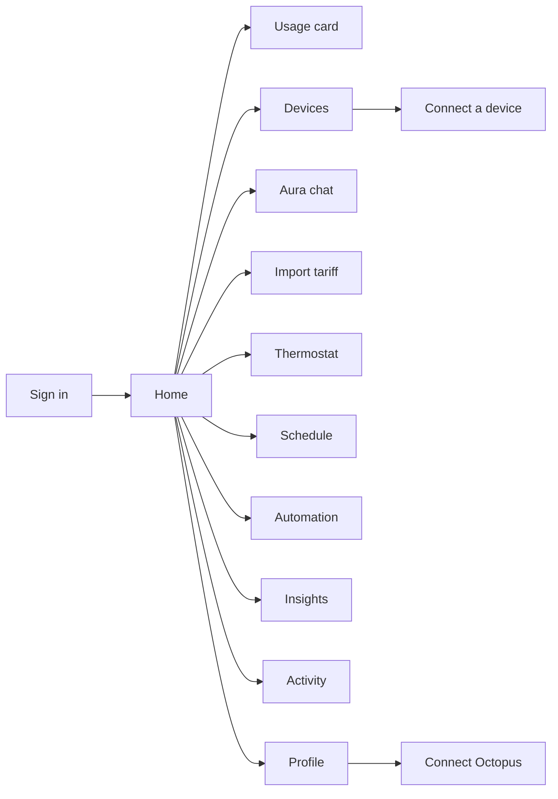
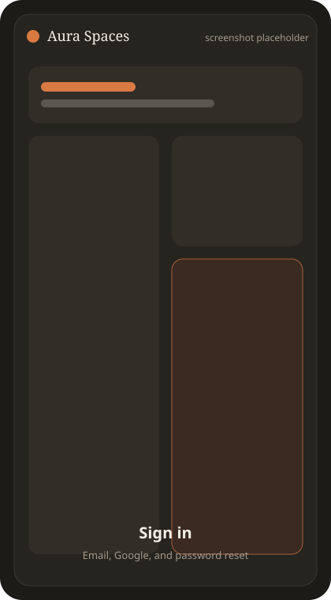
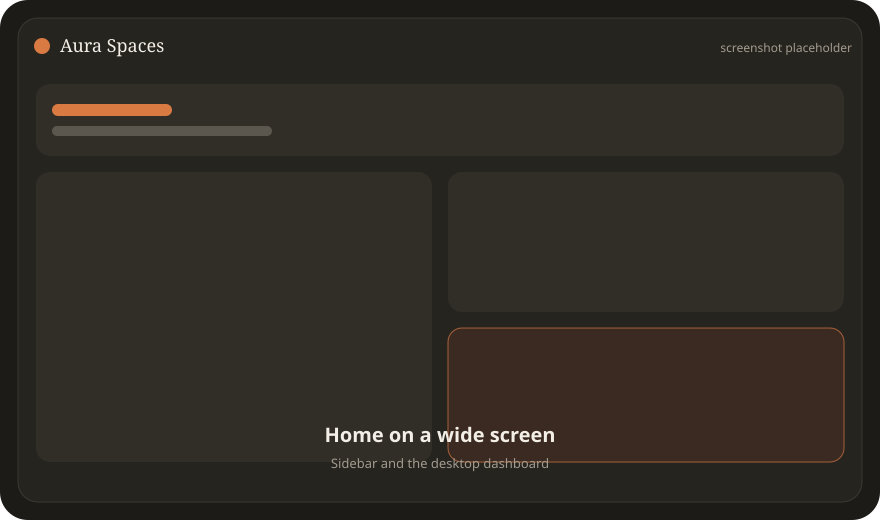
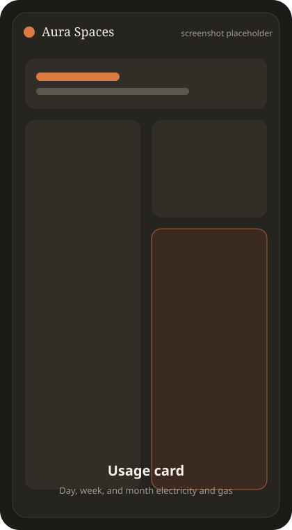
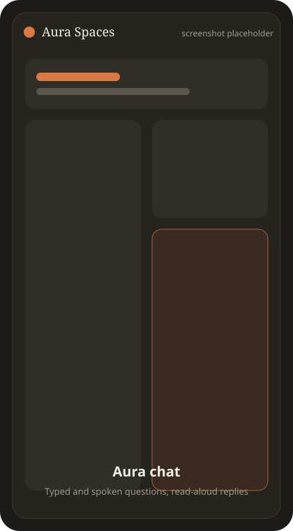
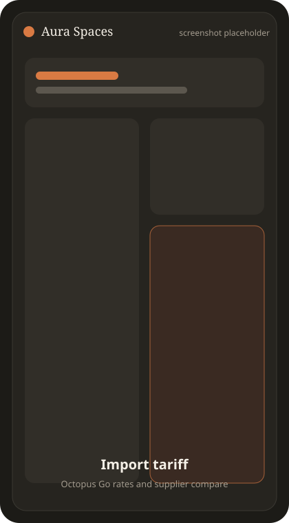
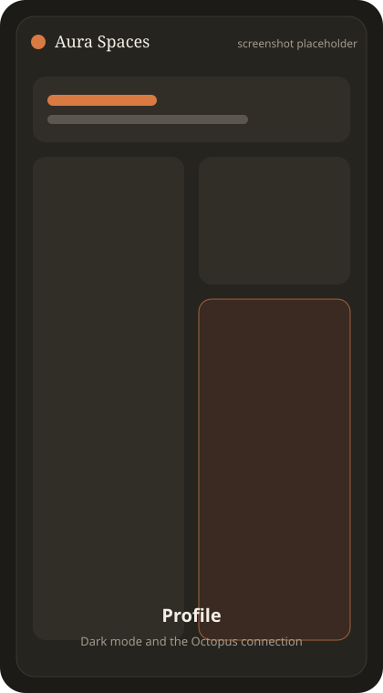
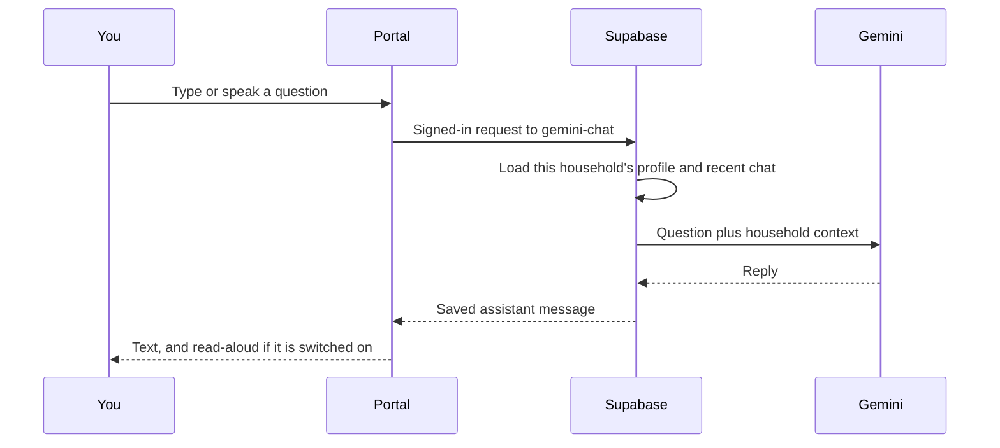
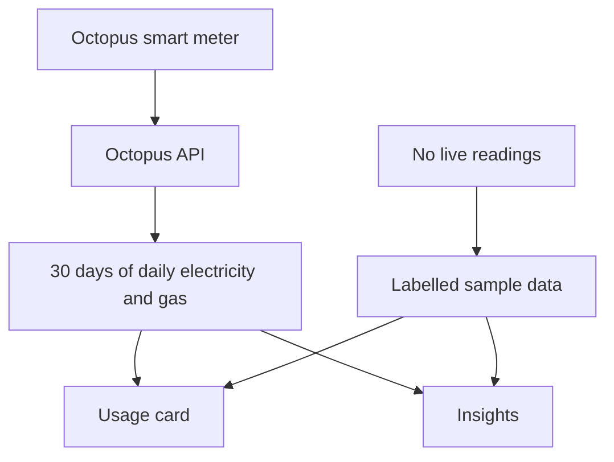
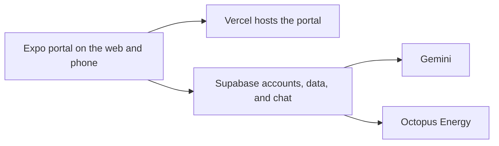

# Aura Spaces

A home energy portal for a UK prepayment household. It shows electricity and gas use, the devices that are drawing power, the current import tariff, and an assistant named Aura that answers questions about that home.

The live portal is at [auraspaces-smart-portal.vercel.app](https://auraspaces-smart-portal.vercel.app).

## What you can do

| | |
| --- | --- |
| Sign in | Email and password, Google, and password reset |
| See the home | A live energy hero, today's electricity and gas, and a welcome with your name |
| Read usage | Day, week, and month charts for electricity and gas, in kWh |
| Charge an EV | A charging card that switches between pounds and kWh |
| Control devices | Categories, rooms, and a power toggle for each device |
| Talk to Aura | Typed questions, on-device speech, and replies that can be read aloud |
| Check the tariff | Octopus Go peak and off-peak rates, plus a link to compare suppliers |
| Plan the home | Thermostat, weekly schedules, and automation rules |
| Review activity | A feed of device changes, automations, savings, and alerts |
| Look at insights | Weekly totals, a daily electricity-and-gas chart, and the largest consumers |
| Set the account | Dark mode, and a private connection to your own Octopus account |

If live meter data is missing, the charts stay up and are labelled as sample data.

## Portal map



On a phone the five tabs are Home, Devices, Insights, Activity, and Profile. On a wide screen the same places sit in a sidebar, with Ask Aura kept in reach.

## Screenshots

These frames are placeholders. Replace each file in `docs/screenshots/` with a real capture of the portal and keep the same file name. A phone-width shot and a desktop shot of Home are the two that matter most.

| Sign in | Home |
| --- | --- |
|  |  |

| Home on a wide screen | Usage |
| --- | --- |
|  |  |

| Aura chat | Import tariff |
| --- | --- |
|  |  |

| Devices | Insights |
| --- | --- |
|  |  |



Suggested captures, taken while signed in at the live portal or at `http://localhost:8083`:

1. `01-sign-in` — the welcome screen, before a session exists
2. `02-home-phone` — Home at a phone width, with the hero and usage card
3. `03-home-desktop` — Home wider than the sidebar breakpoint
4. `04-usage` — the usage card on Week, with electricity and gas
5. `05-aura-chat` — a question and Aura's reply
6. `06-tariff` — Import tariff, including Compare other suppliers
7. `07-devices` — the device list with one device switched on
8. `08-insights` — the weekly summary and daily chart
9. `09-profile` — Profile with Dark mode and Octopus Energy

## How a question reaches Aura

Speech stays on the phone. Only the recognised text is sent.



Aura is written for a prepayment customer. It does not give direct-debit advice, it does not claim to switch a device on, and it does not promise a saving. The Gemini key stays on the server.

## How usage gets onto the chart



Gas readings that arrive in cubic metres are converted to kWh. The newest incomplete day is left off the headline numbers, because smart-meter data usually lags by a day or two.

## Feature detail

### Home

- Energy house hero for the live view of the home
- Usage card with Day, Week, and Month
- EV charging card in £ or kWh
- Devices you can switch from the home screen
- Recent activity
- Import tariff for Octopus Go: standing charge, off-peak 9.00p/kWh from 12:30–4:30am, and peak 31.51p/kWh
- Compare other suppliers, which opens uSwitch
- Shortcuts to the thermostat, schedule, and automation

### Aura

- Chat that remembers the conversation
- Household context, including occupancy, tariff, EV, smart meter, solar, battery, and gas
- This home is treated as having no solar unless the saved profile says otherwise
- Microphone for questions, and an optional spoken reply
- A back control to leave the chat

### Devices, thermostat, schedule, and automation

- Filters for climate, lighting, appliances, and EV
- A connect flow to add a device by category and brand
- Thermostat dial with heat, cool, fan, and off, plus a daily schedule
- Weekly schedule cards for appliances
- Automation rules such as peak-hours eco mode, away mode, and overnight EV charging

### Insights and activity

- Electricity, gas, and combined totals
- Daily electricity against gas
- Use split across the day
- The devices drawing the most
- An activity feed colour-coded by device, automation, saving, and alert

### Account

- Create an account, sign in, reset a password, and sign in with Google
- Light and dark themes, with a glass tab bar on the phone and a sidebar on a wide screen
- Connect Octopus from Profile: API key, electricity MPAN and serial, and optional gas MPRN and serial
- The Octopus key is checked, encrypted, and not shown again

## What runs where



| Piece | Role |
| --- | --- |
| `artifacts/mobile` | The portal: Expo, React Native, and Expo Router |
| `artifacts/api-server` | Optional local API for chat, consumption, and prepay balances |
| `supabase/functions` | Signed-in chat, connecting Octopus, and reading consumption |
| `supabase/migrations` | Household data, devices, 30-day consumption, and chat history |

Secrets are not in the app bundle. The portal only receives the Supabase project URL and the publishable key. Gemini and Octopus keys stay on the server.

## Run it on your computer

From `artifacts/mobile`, with the Supabase URL and publishable key in `.env`:

```bash
./node_modules/.bin/expo start --web --port 8083
```

Open [http://localhost:8083](http://localhost:8083), create an account, and sign in.

The local API, from `artifacts/api-server`:

```bash
npm run start
```

That serves [http://localhost:3000](http://localhost:3000). Chat on that server needs `GEMINI_API_KEY` in `artifacts/api-server/.env`. The start script loads that file. Never commit a `.env` file.

## Replace the screenshot placeholders

1. Open the portal, signed in, at the live site or at `http://localhost:8083`.
2. Capture the nine screens listed above.
3. Export each as an SVG or PNG with the same file name in `docs/screenshots/`.
4. If you use PNG, change the image link in this file from `.svg` to `.png`.
